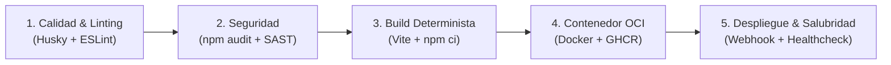
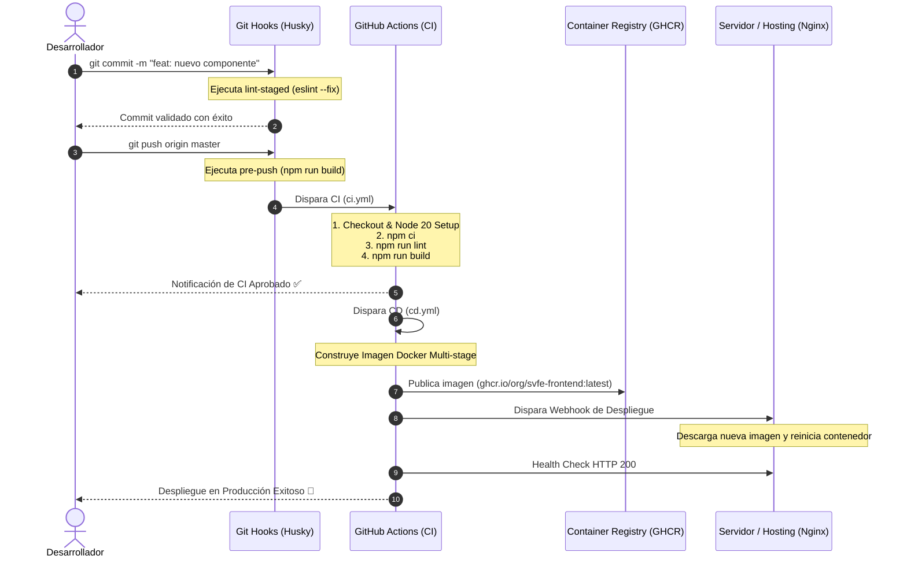

# 🚀 Guía de Arquitectura DevOps: Flujo CI/CD Profesional para Frontend

Esta guía documenta la infraestructura de **Integración Continua (CI)** y **Despliegue Continuo (CD)** implementada para el frontend del Sistema de Facturación Electrónica (SVFE), basada en las mejores prácticas de la industria y **Los 5 Pilares de un Workflow DevOps Profesional**.

---

## 🏛️ Los 5 Pilares de un Workflow DevOps Profesional



### 1. Pilar 1: Integridad y Calidad de Código (Linting & Static Analysis)
* **Objetivo**: Asegurar que ningún código entre al repositorio con errores de sintaxis, variables huérfanas o malas prácticas de React.
* **Componentes**:
  * **Local**: Husky + `lint-staged` ejecutan `eslint --fix` en milisegundos únicamente sobre los archivos staged antes de permitir el commit.
  * **Remoto (CI)**: GitHub Actions valida el 100% del proyecto en un entorno limpio de Ubuntu Linux.

### 2. Pilar 2: Seguridad y Auditoría de Dependencias (Security Scan)
* **Objetivo**: Prevenir vulnerabilidades (CVEs) en las librerías de terceros instaladas.
* **Componentes**:
  * Ejecución de `npm audit --audit-level=high`.
  * Instalación estricta y determinista mediante `npm ci` respetando los hashes de `package-lock.json`.

### 3. Pilar 3: Compilación Determinista y Verificación de Bundle
* **Objetivo**: Garantizar que el empaquetado de producción de Vite genera artefactos válidos y libres de errores de bundling.
* **Componentes**:
  * Ejecución de `vite build` en modo producción.
  * Generación y almacenamiento de artefactos de distribución (`dist/`) como respaldo trazable de la versión compilada.

### 4. Pilar 4: Empaquetado en Contenedores Inmutables y Registro OCI
* **Objetivo**: Empaquetar la aplicación en una imagen Docker ligera y estandarizada para garantizar que corra exactamente igual en cualquier nube.
* **Componentes**:
  * `Dockerfile` Multi-stage (Node 20 Alpine para compilar $\rightarrow$ Nginx Alpine para servir la SPA).
  * Publicación automatizada en **GitHub Container Registry (`ghcr.io`)**.
  * Tagging semántico automático: `latest`, `sha-<hash>`, y versión de release (`v1.0.0`).

### 5. Pilar 5: Despliegue Automatizado y Observabilidad (Continuous Deployment)
* **Objetivo**: Poner en producción las versiones validadas sin intervención manual ni tiempos de inactividad (Zero-Downtime).
* **Componentes**:
  * Disparo de despliegue mediante Webhook seguro (Render, Portainer, CapRover, Coolify, VPS o Kubernetes).
  * **Health Check post-despliegue**: Comprobación HTTP automatizada (`curl -f`) para validar que la aplicación responde correctamente.

---

## 🔄 Flujograma de Integración y Despliegue (Git Pipeline)



---

## 📖 Catálogo de Comandos y sus Funciones

### 1. Comandos de Desarrollo y Calidad Local

| Comando | Función Técnica | Cuándo Usarlo |
| :--- | :--- | :--- |
| `npm run dev` | Inicia el servidor de desarrollo local con Hot Module Replacement (HMR) en el puerto `5173`. | Durante el desarrollo del código día a día. |
| `npx lint-staged` | Ejecuta ESLint con auto-corrección (`--fix`) **únicamente** sobre los archivos que están en el área de preparación (`staged`). | Ejecutado automáticamente por Husky en cada `git commit`. |
| `npm run lint` | Analiza estáticamente **todos** los archivos de código del proyecto para encontrar errores o malas prácticas. | Antes de preparar un pull request o para revisar la deuda técnica. |
| `npm run build` | Compila, minifica y optimiza todos los assets en la carpeta `dist/` usando Vite y Rollup. | Ejecutado automáticamente por Husky en `git push` y en el pipeline CI. |
| `npm run preview` | Levanta un servidor local que sirve los archivos compilados de la carpeta `dist/` para probar cómo se comportará en producción. | Antes de publicar cambios importantes para validar el bundle final. |

---

### 2. Comandos de Contenedores y Docker

| Comando | Función Técnica | Cuándo Usarlo |
| :--- | :--- | :--- |
| `docker build -t svfe-frontend:latest .` | Construye localmente la imagen Docker usando el `Dockerfile` multi-stage y el servidor Nginx. | Para probar que la imagen de contenedor compila sin errores. |
| `docker run -d -p 3000:80 --name svfe-app svfe-frontend:latest` | Ejecuta el contenedor en segundo plano mapeando el puerto `3000` de tu máquina al puerto `80` de Nginx. | Para probar la SPA montada en Nginx localmente en `http://localhost:3000`. |
| `docker logs -f svfe-app` | Muestra los registros y accesos HTTP en tiempo real del contenedor Nginx. | Para depurar errores de rutas 404 o configuración de Nginx. |
| `docker stop svfe-app && docker rm svfe-app` | Detiene y elimina el contenedor local de pruebas. | Para limpiar recursos en tu computadora. |

---

### 3. Comandos de Husky y Control de Versiones

| Comando | Función Técnica | Cuándo Usarlo |
| :--- | :--- | :--- |
| `npx husky init` | Inicializa Husky en el proyecto, crea la carpeta `.husky/` y agrega el script `"prepare": "husky"` en `package.json`. | Solo se ejecuta una vez al configurar el repositorio. |
| `git commit -m "..."` | Registra los cambios en el historial de Git, disparando previamente el hook `.husky/pre-commit`. | Para guardar versiones de código locales. |
| `git commit -m "..." --no-verify` | Guarda el commit **omitiendo** las validaciones de Husky (Emergency bypass). | ⚠️ Solo en emergencias críticas si un hook bloquea un fix urgente. |
| `git push origin <rama>` | Envía los commits locales al repositorio remoto en GitHub, disparando el hook `.husky/pre-push` y los workflows de GitHub Actions. | Para sincronizar tu trabajo con el equipo y la nube. |

---

## 🔐 Configuración de Secretos en GitHub Actions

Para habilitar el despliegue automático del archivo [cd.yml](file:///c:/Users/ale_d/Documents/Creapx/2026/FACT_V2/frontend/.github/workflows/cd.yml), ve a tu repositorio en GitHub $\rightarrow$ **Settings** $\rightarrow$ **Secrets and variables** $\rightarrow$ **Actions** y agrega los siguientes secretos:

| Nombre del Secreto | Descripción | Ejemplo de Valor |
| :--- | :--- | :--- |
| `DEPLOY_WEBHOOK_URL` | *(Opcional)* URL de Webhook para refrescar el contenedor en tu proveedor de hosting (Render, Portainer, CapRover, Coolify). | `https://api.render.com/deploy/srv-xxxxxx?key=yyyyyy` |
| `PRODUCTION_URL` | *(Opcional)* URL pública de tu frontend en producción para realizar el Health Check HTTP automático tras el despliegue. | `https://factura.tudominio.com` |
| `GITHUB_TOKEN` | Token nativo generado por GitHub automáticamente con permisos para publicar en `ghcr.io`. | *(No requiere configuración manual, GitHub lo inyecta)* |

---

## 📁 Estructura de Archivos del Flujo DevOps

```text
frontend/
├── .github/
│   └── workflows/
│       ├── ci.yml                 # Pipeline de Integración Continua (Lint + Audit + Build)
│       └── cd.yml                 # Pipeline de Despliegue Continuo (Docker + GHCR + Webhook)
├── .husky/
│   ├── pre-commit                 # Hook local: npx lint-staged
│   └── pre-push                   # Hook local: npm run build
├── Dockerfile                     # Construcción Multi-stage optimizada (Node 20 -> Nginx Alpine)
├── nginx.conf                     # Configuración de servidor Nginx para SPA (React Router)
├── package.json                   # Scripts y bloque "lint-staged"
└── DEVOPS_WORKFLOW_GUIA.md        # Documentación y referencia de comandos
```
